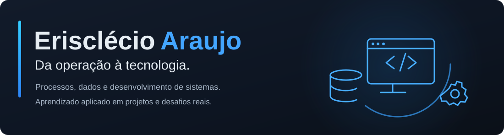
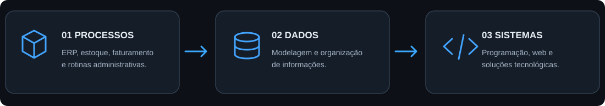
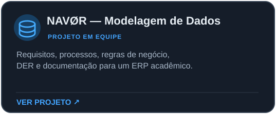
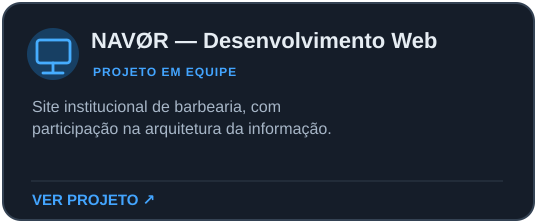

  

  <strong>Estudante de Análise e Desenvolvimento de Sistemas</strong> · São Paulo, Brasil

---

##  Sobre mim

Minha experiência profissional está ligada à **organização de processos e informações**: rotinas administrativas, sistemas ERP, controle de estoque, faturamento, emissão de notas fiscais e operações de e-commerce.

Hoje, curso **Análise e Desenvolvimento de Sistemas (ADS)** e estou construindo minha base em programação, modelagem de bancos de dados e desenvolvimento web. Tenho interesse especial em **dados e banco de dados**, áreas nas quais posso conectar minha vivência operacional à tecnologia.

##  Minha trajetória

  

##  Conhecimentos e ferramentas

  

**Na graduação:** lógica de programação, programação em C, fundamentos de Python, HTML e modelagem de dados.  
**Na prática profissional:** Excel, sistemas ERP, registros operacionais, faturamento e organização de informações.

> As tecnologias apresentadas incluem conhecimentos em estudo. Não representam domínio avançado de todas as ferramentas.

##  Projetos em destaque

<!-- PORTFOLIO:START -->
<table>
  <tr>
    <td width="50%" align="center" valign="top">
      
    </td>
    <td width="50%" align="center" valign="top">
      
    </td>
  </tr>
</table>

Os dois projetos foram desenvolvidos **em equipe** na graduação. No projeto de modelagem, apresento o trabalho coletivo de análise e documentação de um banco de dados para um futuro ERP; no site, minha participação esteve ligada à **arquitetura da informação**.

**[Explorar o projeto de modelagem](https://github.com/Erisclecio/ModelagemBarbearia_NAVOR_)** · **[Explorar o projeto web](https://github.com/Erisclecio/FrontEnd_NAVOR)** · **[Visualizar o site](https://erisclecio.github.io/FrontEnd_NAVOR/html/index.html)**
<!-- PORTFOLIO:END -->

##  Direção de aprendizado

Estou concentrado em fortalecer os fundamentos de **SQL, modelagem de dados e programação**, evoluindo por meio de exercícios e projetos. Meu objetivo é compreender como as informações são estruturadas e como sistemas podem apoiar processos e decisões.

Este GitHub é meu espaço para reunir projetos, registrar aprendizados e documentar minha evolução técnica.

##  Conexões

  
  

